<p align="center">
  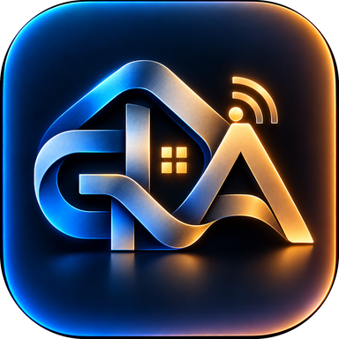
</p>

<h1 align="center">GdAHome OS</h1>

<p align="center">
  <b>Il sistema dei pannelli a muro GdAHome.</b><br>
  Un Sonoff NSPanel Pro diventa un pannello GdAHome e basta: niente Sonoff, niente eWeLink,<br>
  niente app che non servono. Si accende col marchio GdAHome e apre la plancia a muro.
</p>

<p align="center">
  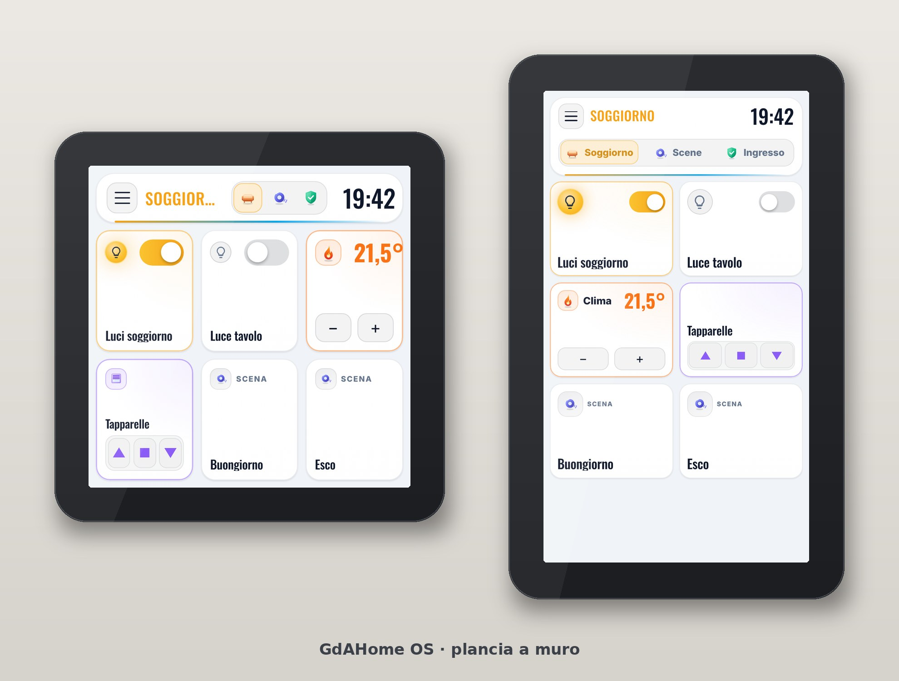
</p>
<p align="center"><sub>La plancia a muro vera di GdAHome, alle risoluzioni dei due pannelli, in proporzione: NSPanel Pro 86 (3,95", 480×480) e NSPanel Pro 120 (4,7", 750×1334).</sub></p>

---

## Cosa c'è sul pannello

GdAHome OS è pensato **solo per i pannelli a muro**. Sul pannello resta quello che serve
e nient'altro, perché un PX30 con 2 GB di memoria vada veloce:

| Pezzo | Cosa fa |
| --- | --- |
| **App GdAHome** (`com.gdahome.gdahome`) | L'interfaccia: la **plancia a muro** di GdAHome, abbinata all'add-on di casa. È l'app ufficiale, la stessa del telefono. |
| **GdAHome OS** (`com.gdahome.os`) | Lo strato di sistema. È la schermata home: all'accensione apre GdAHome e la riapre se si chiude. Gestisce relè, Zigbee, sensori e MQTT. |
| `gdaserial` | Il ponte del chip Zigbee integrato verso la rete, per Zigbee2MQTT e ZHA. |
| Animazione d'avvio | Il marchio GdAHome, nello stile dell'avvio dell'app, per 480×480 e 750×1334. |
| Android 8.1, alleggerito | Senza app Sonoff/eWeLink e senza le app inutili a muro: browser, galleria, musica, sfondi animati, stampa e altre. |

Kernel e driver restano quelli originali (schermo, touch, Wi-Fi, GPIO): sono gli unici che
conoscono l'hardware del pannello.

```
┌───────────────────────────────────────────────────┐
│  App GdAHome · plancia a muro                     │  ← l'interfaccia
├───────────────────────────────────────────────────┤
│  GdAHome OS · avvio, relè, Zigbee, sensori, MQTT  │  ← /system/app/GdAHomeOS
│  gdaserial · animazione d'avvio GdAHome           │  ← /system/bin, /system/media
├───────────────────────────────────────────────────┤
│  Android 8.1 alleggerito, senza Sonoff            │
├───────────────────────────────────────────────────┤
│  Kernel e driver originali                        │
└───────────────────────────────────────────────────┘
```

## Le schermate

Sono le schermate vere della plancia a muro di GdAHome, fotografate con la casa delle prove
a muro (`docs/fotografa-il-muro.mjs`).

| | NSPanel Pro 86 | NSPanel Pro 120 |
| --- | --- | --- |
| L'avvio | 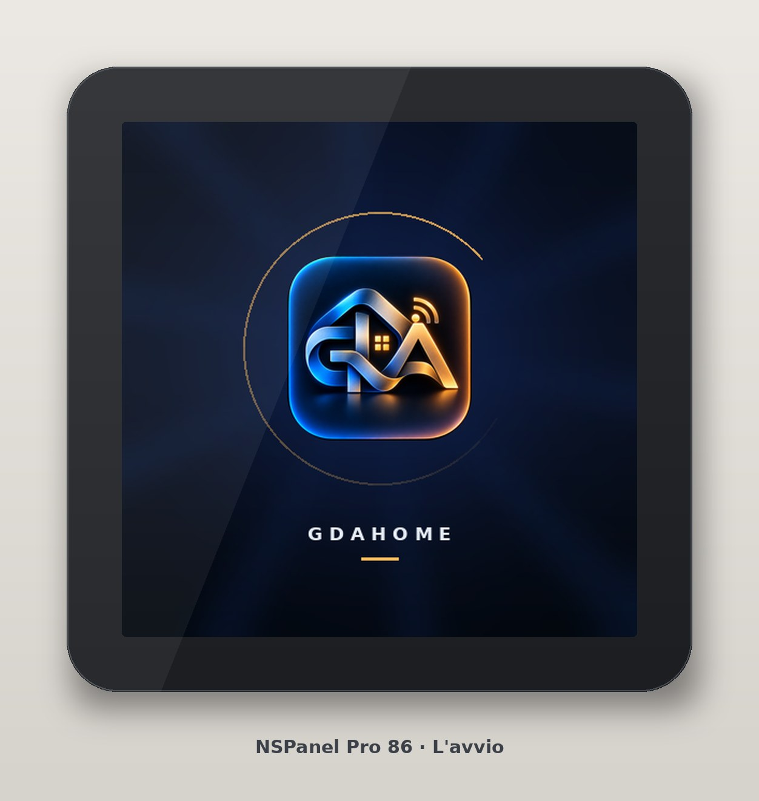 | 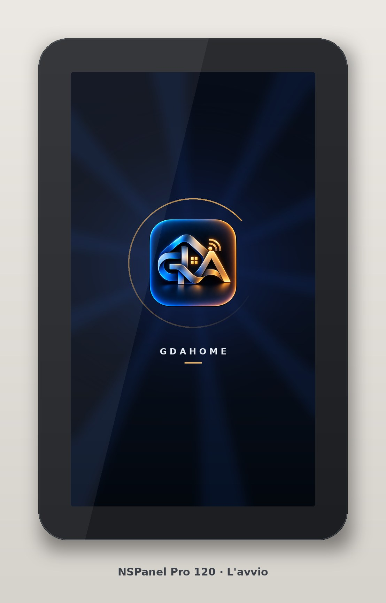 |
| La stanza | 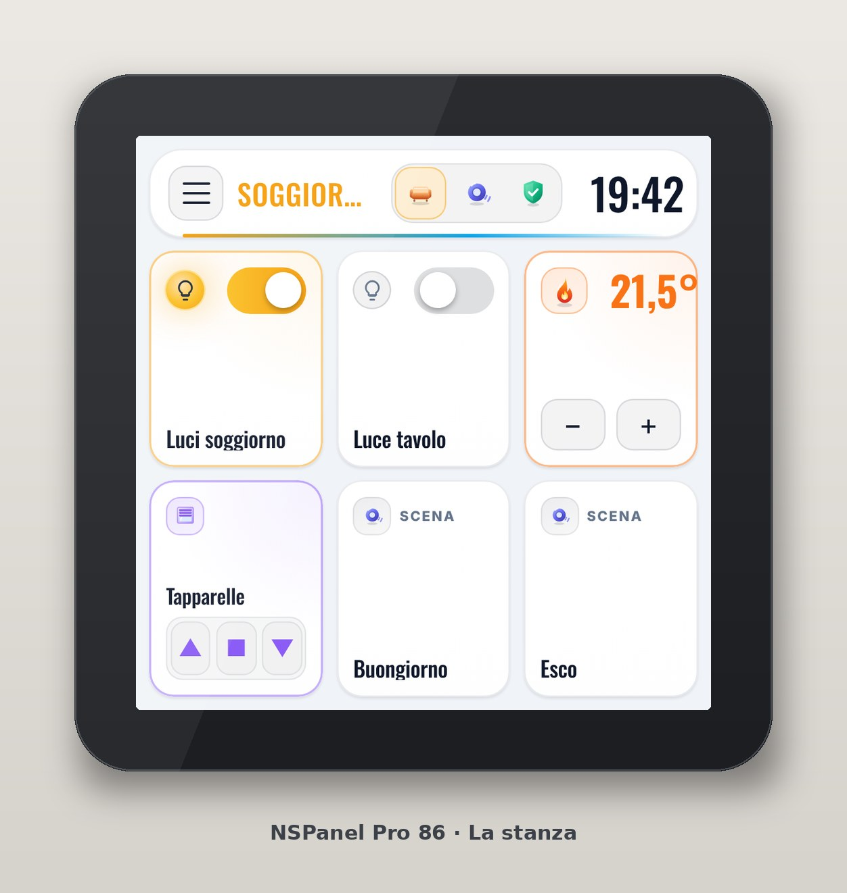 | 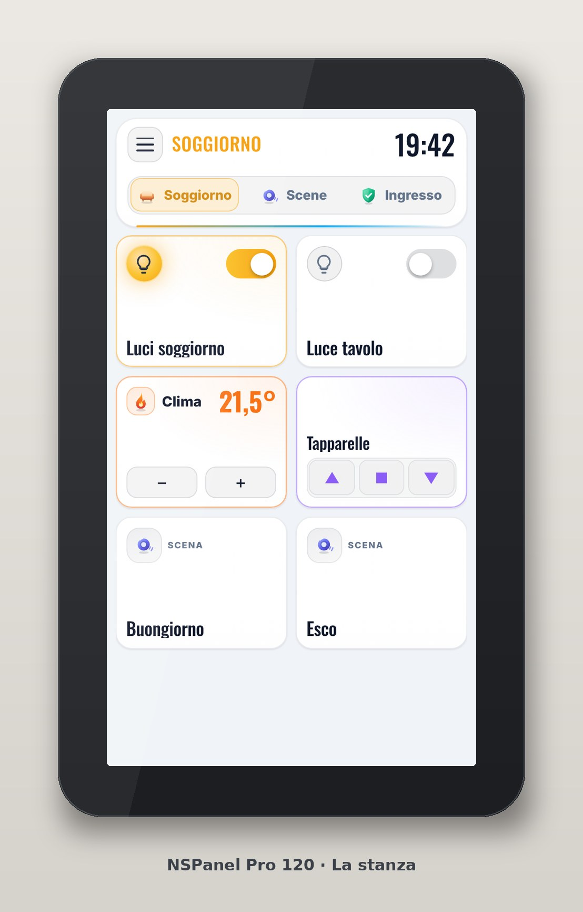 |
| Le scene | 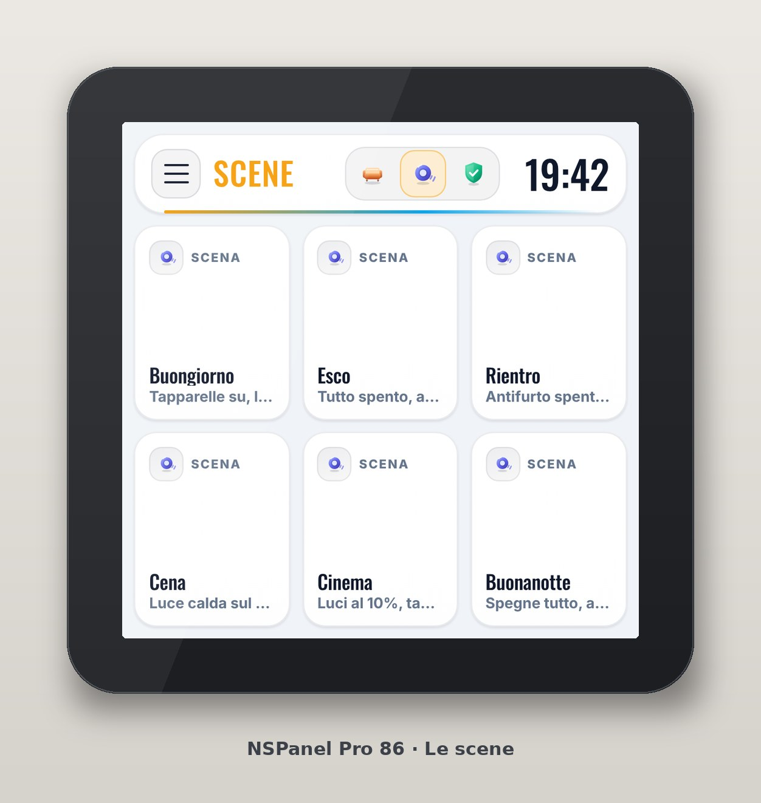 | 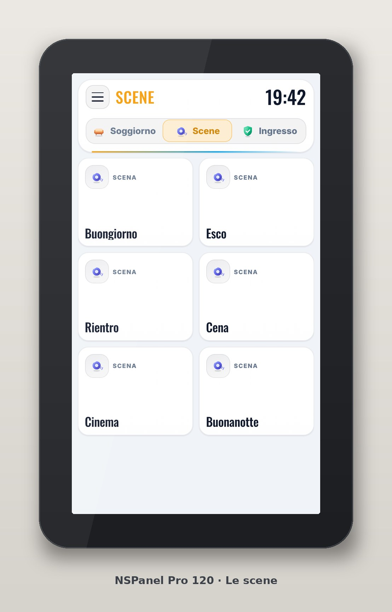 |
| L'ingresso | 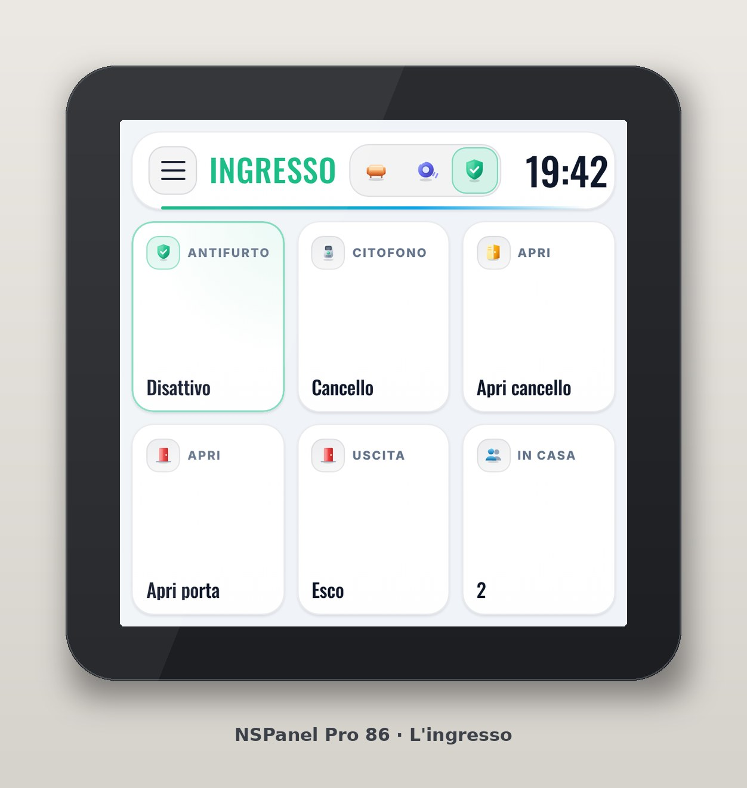 | 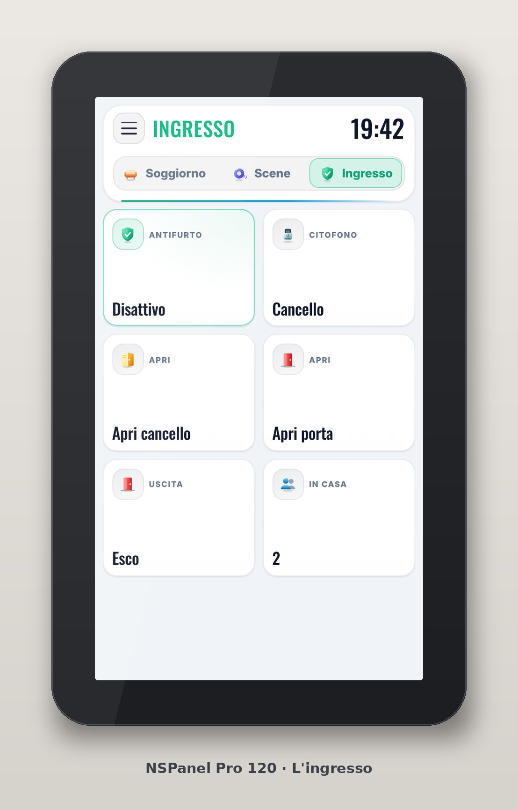 |
| Il riposo | 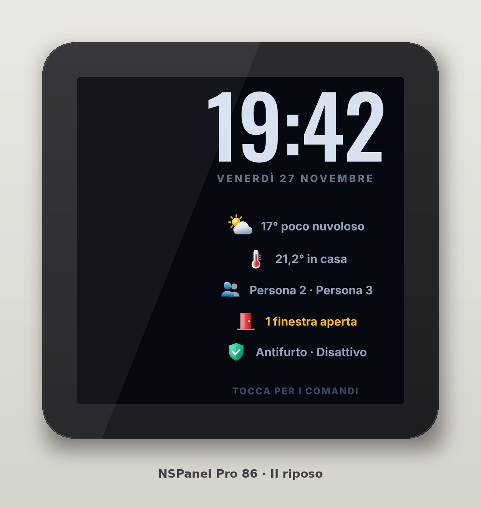 | 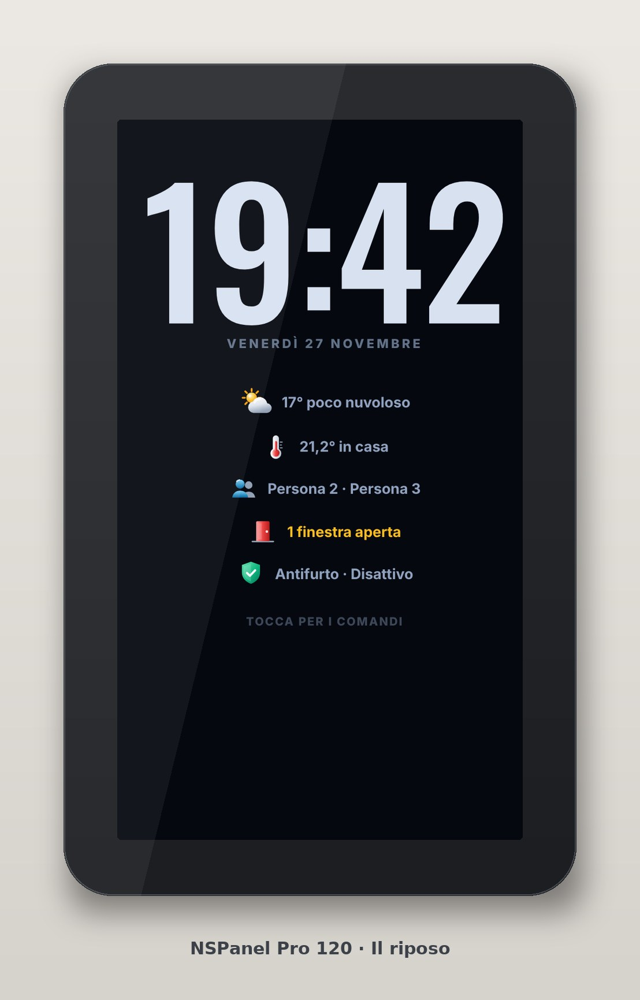 |

Il riposo, la luminosità, il sensore di prossimità e la notte li gestisce l'app GdAHome
(canale `gdahomeSchermo`). GdAHome OS fa in modo che Android non spenga mai lo schermo da
solo: su questo firmware, senza Sonoff, uno schermo spento non si riaccende più.

## Cosa serve

- I file della build: **Actions → GdAHome OS → ultima esecuzione → Artifacts → `GdAHome-OS`**.
- **`GdAHome.apk`**, l'app GdAHome ufficiale per Android, da mettere nella stessa cartella.
- Una **WebView recente** (108 o più). La plancia gira nella WebView di sistema e quella
  originale del NSPanel è troppo vecchia. `check` dice quale c'è: se serve, metti
  `webview.apk` nella cartella e l'installazione la aggiorna.
- Un PC con [Android platform-tools](https://developer.android.com/tools/releases/platform-tools)
  (`adb`) e bash: Linux, macOS, oppure Git Bash o WSL su Windows.
- La casa con l'add-on GdAHome e una plancia **«A muro»** (Premium).

## Installare

### 0. Abilitare ADB

1. Associa il pannello all'app eWeLink, se non l'hai già fatto.
2. Nell'app eWeLink apri la pagina del pannello e **tocca più volte l'ID dispositivo** finché si
   attiva la modalità sviluppatore. Poi attiva ADB.
3. ⚠️ Sonoff avvisa che l'accordo ADB è **irreversibile**: il pannello non riceverà più
   aggiornamenti Sonoff.
4. Annota l'IP del pannello.

### 1. Verifica

```bash
./gdahome-os.sh check 192.168.1.50
```

Il comando riconosce il modello (86 o 120) e controlla:
- root e dm-verity;
- memoria;
- versione della WebView;
- presenza di `GdAHome.apk`.

Prepara anche l'elenco di cosa togliere in
`gdahome-os-data/<modello>-<seriale>/packages-to-remove.txt`. Le app Sonoff e quelle superflue
sono già selezionate; le altre sono segnate con `#` perché tu le verifichi. I componenti di base
di Android sono protetti: se finiscono nell'elenco, l'installazione si ferma.

### 2. Backup (obbligatorio)

```bash
./gdahome-os.sh backup 192.168.1.50
```

Copia **tutte le partizioni** sul PC e le verifica con MD5. Restano escluse `userdata` e `cache`:
aggiungi `--with-userdata` per includerle. Senza un backup valido l'installazione non parte.
**Conservalo.**

### 3. Installazione

```bash
./gdahome-os.sh install 192.168.1.50
```

Chiede di scrivere `GDAHOME` per confermare, poi:

1. installa la WebView, se serve, e l'**app GdAHome** con i permessi per il pannello: microfono
   per il citofono, nessun limite di batteria;
2. sposta le app Sonoff e quelle superflue fuori dal sistema, in `/system/gdahome-removed`.
   Si possono rimettere;
3. installa **GdAHome OS** come app di sistema, il ponte Zigbee e l'animazione d'avvio del modello;
4. imposta il sistema da pannello a muro:
   - schermo mai spento da Android;
   - barre nascoste e niente salvaschermo di Android;
   - animazioni dimezzate;
   - niente ricerche Wi-Fi o Bluetooth in sottofondo e niente posizione;
   - Wi-Fi sempre acceso;
5. tiene **ADB attivo sulla porta 5555**: senza Sonoff nessuno lo riattiverebbe;
6. riavvia in GdAHome OS.

Se la WebView è vecchia e manca `webview.apk`, si ferma **prima** di toccare il sistema.

### 4. Primo avvio

Sul pannello si apre GdAHome:

1. **abbina** il pannello alla casa con il codice dell'add-on GdAHome;
2. apri **Configurazione → Configura Entità → scheda «A muro»** e accendi «Usa questa plancia a
   muro» (vedi il [manuale di GdAHome](https://github.com/danigio15/gdahomeapp/blob/main/docs/MANUALE.md), capitolo 8.3).

### Aggiornare e tornare indietro

```bash
./gdahome-os.sh aggiorna 192.168.1.50   # nuova GdAHome.apk e/o GdAHome-OS.apk
./gdahome-os.sh restore  192.168.1.50   # rimette Sonoff (--togli-gdahome toglie anche l'app)
```

**Emergenza**: `./gdahome-os.sh flash 192.168.1.50 system <backup>/system.img` riscrive una
partizione dal backup. Se il pannello non si avvia e ADB non risponde, le immagini del backup si
riscrivono in modalità Rockchip loader con `rkdeveloptool`, con l'accesso USB alla scheda.

## Le impostazioni del pannello

Nella schermata d'avvio **tieni premuto il marchio** e inserisci il PIN (predefinito **1234**,
cambialo). Si arriva lì quando GdAHome è chiusa: dopo un tocco l'avvio si ferma e mostra
«Apri GdAHome» e «Impostazioni».

- **MQTT**: il broker di casa (es. Mosquitto in Home Assistant). Il pannello compare in Home
  Assistant come dispositivo **GdAHome OS** con:
  - i relè;
  - la presenza (prossimità);
  - la temperatura e la luce ambiente;
  - i tasti «Riapri GdAHome», «Riavvia pannello» e «Analisi hardware».

  Da lì li metti nella plancia a muro come ogni altra entità.
- **Relè**: numero GPIO o percorso sysfs. Si trovano con l'Analisi hardware.
- **Zigbee integrato**: la porta seriale del chip. Zigbee2MQTT lo usa come
  `tcp://IP-pannello:6638` (`adapter: ember`), ZHA come `socket://IP-pannello:6638`.
- **Analisi hardware**: elenca GPIO, retroilluminazione, sensori, porte seriali, versione di
  GdAHome e della WebView, memoria. Il rapporto va anche su MQTT in `gdahome/<id>/probe`.

### Trovare i relè

Sonoff non documenta i GPIO dei relè. Dall'Analisi hardware prendi i GPIO `out` e provali uno
alla volta, ascoltando il clic:

```bash
adb shell su -c 'echo 1 > /sys/class/gpio/gpioNN/value'
adb shell su -c 'echo 0 > /sys/class/gpio/gpioNN/value'
```

## Topic MQTT

| Topic | Payload |
| --- | --- |
| `gdahome/<id>/relay1/set`, `relay2/set` | `ON` / `OFF` |
| `gdahome/<id>/command` | `riapri_app`, `riavvia`, `probe` |
| `gdahome/<id>/proximity/state`, `temperature/state`, `illuminance/state` | in uscita |
| `gdahome/<id>/probe` | rapporto dell'analisi hardware |
| `gdahome/<id>/status` | `online` / `offline` |

## Da sapere

- **ADB resta aperto in rete** (porta 5555, con root): tieni i pannelli su una rete fidata o in
  una VLAN separata.
- **Le notifiche push** dell'app GdAHome usano Firebase, che senza i servizi Google non parte:
  sul pannello non servono, e la plancia funziona lo stesso.
- GdAHome OS è stato provato **in simulazione** (installazione, protezioni e ripristino) e le
  schermate sono quelle vere della plancia. Non è ancora stato provato su un NSPanel reale:
  segui i passi in ordine e non saltare il backup.

## Sviluppo

```
gdahome-nspanel/
├── app/       GdAHome OS (Kotlin, Android 8.1+): avvio, servizio, relè, Zigbee, sensori, MQTT
├── native/    gdaserial.c: ponte UART ↔ TCP per il chip Zigbee (C, NDK)
├── os/        gdahome-os.sh, il marchio, l'animazione d'avvio (make_bootanimation.py)
├── tools/     installazione leggera via ADB, senza toccare il sistema
└── docs/      i render della plancia a muro (fotografa-il-muro.mjs, make_mockups.py)
```

I render si rifanno con il repository `gdahomeapp` accanto:

```bash
(cd ../gdahomeapp/officina && npm ci)
node docs/fotografa-il-muro.mjs ../gdahomeapp && python3 docs/make_mockups.py
```

GdAHome OS è firmato con `keystore/gdahome-sideload.jks`, così si aggiorna senza disinstallarlo.
È una chiave pubblica, per uso personale.
